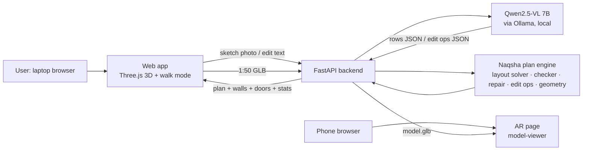
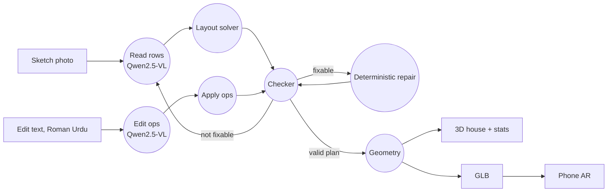
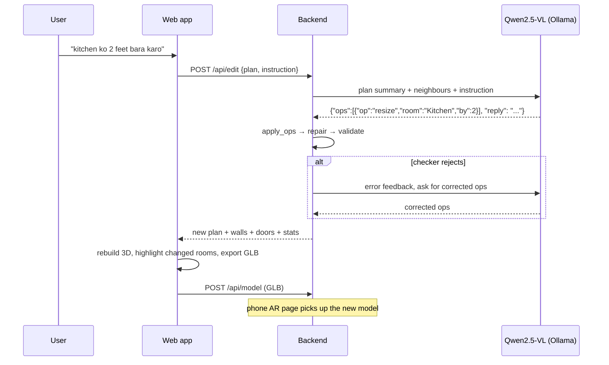

# Naqsha نقشہ

**Turn a hand-drawn house plan into a 3D house you can walk through, edit by typing in Roman Urdu or English, and place on a table in AR. It runs locally on an open-weight 7B model.**

| | |
|---|---|
| **Event** | Hacktoberfest Islamabad 2026, Open AI Build Challenge |
| **Domain** | 04 · Community & Social Good |
| **Entry type** | Application built on an open-weight model (not an Agent Skill or a model harness) |
| **Target users** | Families in Pakistan planning to build a house, and the local contractors (*thekedars*) who sketch plans with them |
| **Model** | Qwen2.5-VL-7B-Instruct (7B, open weights, Apache-2.0) via Ollama, running locally |
| **License** | [MIT](LICENSE) |

**Contents:** [Problem](#problem) · [Solution](#solution) · [AI component](#ai-component) · [Architecture](#architecture) · [Setup](#setup) · [Demo](#demo) · [Testing and findings](#testing-and-findings) · [Team](#team) · [License](#license) · [Acknowledgements](#acknowledgements)

---

## Problem

Most families in Pakistan who build a house start the same way: a sketch on paper, often with a local contractor ("5 marla, two bedrooms, drawing room in front"). Most people can't picture a 2D sketch in 3D. Changes mean redrawing by hand, and nobody can tell what a room size like "12x14" will actually feel like until the walls are built. Architectural 3D software is expensive and complex, and the AI tools that do exist rely on closed cloud models.

## Solution

Naqsha takes a **photo of the sketch** and:

1. **Reads it** with an open-weight vision model (Qwen2.5-VL 7B) running locally.
2. **Lays it out and checks it** with our own layout solver and geometry checker, which fix the mistakes small models make.
3. **Builds a 3D house**: walls with door openings, floors and labels, with an orbit view and a first-person **walk mode**.
4. **Edits the house from instructions in plain language**, e.g. *"kitchen ko 2 feet bara karo"* ("make the kitchen 2 feet bigger") or *"Bedroom 2 ke saath 7x8 ka washroom bana do"* ("build a 7x8 washroom next to Bedroom 2"). The model turns the instruction into structured edit operations, our engine applies them, and the house updates with the changed rooms highlighted.
5. **Shows it on a table in AR**: scan a QR code and a 1:50 model of the house appears on the table through the phone browser, with no app. Edits on the laptop update the phone.
6. Shows **covered area, plot size in marla and a rough construction cost in PKR**, using a rate you enter.

### Core features

- Sketch photo → 3D house in about 10–20 s on a laptop GPU
- Walk mode (WASD + mouse) and a top view
- Natural-language edits: resize, add, remove, rename, swap rooms, add or remove doors; undo
- AR on a phone (`<model-viewer>`: Scene Viewer on Android, Quick Look on iOS)
- Area, marla and cost panel (sq ft per marla and the rate are configurable)
- Visible checker log: every automatic fix and model retry is shown in the UI
- Architect-style planner: one main gate on the car porch, guest entrance into the drawing room, family entrance into the lounge, kitchen/bedrooms/baths never off the garage
- Textured 3D: marble, wood, tile, paver and grass floors, 8 ft doors with frames, a steel main gate with pillars, driveway and street, furniture, a car and trees (all procedural, works offline and in AR)

---

## AI component

| | |
|---|---|
| **Model** | `qwen2.5vl:7b`: Qwen2.5-VL-7B-Instruct, **7 billion parameters**, open weights (Apache-2.0) |
| **Runtime** | [Ollama](https://ollama.com) 0.40, running locally (tested on an RTX 4080 Laptop GPU with 12 GB) |
| **Tested alternative** | `gemma4:e4b`: Gemma 4 E4B, 7.98B total parameters (7.5B language + 0.48B vision), open weights. About 2× faster, slightly less accurate (see [Benchmark](#benchmark-naive-model-only-approach-vs-naqsha)) |
| **Integration** | Ollama `/api/chat` with JSON-schema structured output (`format`), temperature 0. Code: `server/llm.py` |
| **What it does** | (1) **Vision:** reads room names, written dimensions and doors from the sketch photo. (2) **Language:** turns English, Urdu and Roman Urdu edit instructions into structured edit operations. |

Both models are within the event's 8B-parameter limit. No API keys and no cloud API are used.

### Why the AI is central

Without the model there is no way to get from a photo to a plan, and no way to edit the house by typing. Removing it would leave a 3D viewer that someone has to fill in by hand, room by room. The model does the two core jobs of the product: **reading the sketch** and **understanding the user's instructions**.

### Our original contribution

The model alone is not enough. When we asked Qwen2.5-VL-7B to output room coordinates directly, it read names and sizes correctly but **placed rooms in the wrong positions** (overlapping rooms, impossible doors). Re-prompting with the errors didn't help, because it repeated the same layout. So we built the parts that make a small model reliable:

| Component | File | What we built |
|---|---|---|
| **Row-based reading + layout solver** | `server/plan.py: layout_rows` | The model only reports what small vision models are good at (room names and written sizes, row by row). Our solver computes the coordinates and reconciles inconsistent sizes, e.g. a row that is 2 ft short. |
| **Geometry checker** | `plan.validate`, `plan.unreachable` | Detects overlaps, doors in walls the two rooms don't share, missing exterior walls, duplicate names, implausible sizes and rooms you can't reach. |
| **Deterministic repair** | `plan.repair` | Snaps near-miss edges (within 1 ft) into shared walls, drops impossible doors, and adds doors so every room is reachable (main entrance placed on the porch or drawing room). |
| **Model feedback loop** | `server/llm.py: read_sketch` | Any errors the checker can't fix are sent back to the model to re-read, for up to 2 rounds. |
| **Edit engine** | `plan.apply_ops` | Resizing inserts or removes a strip of space across the whole house, so neighbouring rooms are pushed instead of overlapped and walls stay aligned. Adding a room inserts space and fills it. Swap and rename keep doors consistent. Fuzzy room-name matching. |
| **Planner (door layout)** | `plan.plan_circulation` | Re-lays the doors the way a Pakistani house is planned: a main gate on the porch's street side, porch → drawing room for guests, porch → lounge for family, kitchen off the lounge/dining, baths off a bedroom or the lounge, never a route through a bath. Every change is shown in the log. |
| **2D → 3D geometry** | `plan.geometry`, `web/app.js` | Merges room edges into continuous walls, cuts door openings with lintels above them, builds 9-inch (0.75 ft) brick walls, and exports a 1:50 GLB for AR. |
| **Benchmark** | `bench/` | A synthetic hand-drawn-style sketch generator with ground truth, and a runner comparing the naive approach with Naqsha's pipeline. |

Third-party building blocks (not our work): Qwen2.5-VL, Ollama, Three.js, model-viewer, FastAPI, qrcodejs. See [Acknowledgements](#acknowledgements).

---

## Architecture

### System architecture



### Data flow diagram



### Sequence: editing the house



There is no database, so there is no ER diagram. The plan lives in the browser as JSON and is sent with each request; the server only keeps the latest GLB in memory for the phone.

### Repository structure

```text
├── server/
│   ├── app.py            FastAPI app: API routes, serves the web app and the AR model
│   ├── llm.py            Ollama calls: sketch reading, edit instructions, feedback loop
│   └── plan.py           Plan engine: layout solver, checker, repair, edit ops, planner, geometry
├── web/
│   ├── index.html        Main app (upload, 3D view, edit box, stats, QR code)
│   ├── app.js            Three.js scene, walk mode, textures, GLB export
│   ├── ar.html           Phone AR page (model-viewer)
│   └── style.css
├── tests/test_plan.py    Unit tests for the plan engine (no model needed)
├── bench/                Synthetic sketch generator, benchmark runner and results
├── samples/              Sample plans and sketch images (5, 7, 10 marla, 1 kanal)
├── team/                 Task notes for each team member during the build
├── PLAN.md               Build plan
├── requirements.txt
└── LICENSE               MIT
```

---

## Setup

### Requirements

- Python 3.10+
- [Ollama](https://ollama.com) (0.30.9 or newer for Gemma 4)
- A GPU with about 8 GB or more of VRAM (it also runs on CPU, slowly)
- Python packages (`requirements.txt`): `fastapi`, `uvicorn[standard]`, `python-multipart`, `httpx`, and `pillow` (only for the benchmark sketch generator)
- The web pages load Three.js 0.160.0, model-viewer 3.5.0 and qrcodejs 1.0.0 from public CDNs, so the browser needs internet access the first time

### Install and run

```bash
git clone https://github.com/Mohammad-Sofyan-Abdullah/Hacktoberfest.git
cd Hacktoberfest
pip install -r requirements.txt
ollama pull qwen2.5vl:7b
python -m uvicorn server.app:app --host 0.0.0.0 --port 8000
```

Open http://localhost:8000. Click **Load sample 10 marla** to try it without a sketch, or upload a photo.

### Configuration

Environment variables (all optional):

| Name | Default | Meaning |
|---|---|---|
| `OLLAMA_URL` | `http://127.0.0.1:11434` | Ollama server |
| `NAQSHA_MODEL` | `qwen2.5vl:7b` | Any Ollama vision model ≤ 8B total parameters, e.g. `gemma4:e4b` |
| `NAQSHA_REPAIR_ROUNDS` | `2` | Max model re-read rounds after checker feedback |

No API keys are needed.

### Run the tests

```bash
python -m unittest discover -s tests -t . -v
```

### Drawing a sketch that reads well

Draw rectangular rooms in horizontal rows, write the name and size inside each room (`Kitchen 12x10`, width × depth in feet), and mark doors as gaps or arcs. Grid paper helps.

### AR on a phone

Connect the phone to the same Wi-Fi and scan the QR code in panel 4, then tap **View on your table**. If Windows asks, allow Python through the firewall on private networks. Android's WebXR mode needs HTTPS. Scene Viewer and iOS Quick Look are tried first; if they fail, expose port 8000 over HTTPS with a tunnel (e.g. `cloudflared tunnel --url http://localhost:8000`) and open the tunnel URL plus `/ar.html`.

---

## Demo

### Usage example

```text
Upload sketch  →  "model read the sketch · 11 rooms · 10.1s"  →  "✓ Checker: plan is buildable"
Edit: kitchen ko 2 feet bara karo
  → "Kitchen 2 feet bara ho gaya"
    Kitchen grew 2 ft on the east side
    also stretched to keep walls aligned: Car Porch, Bedroom 1, Lawn
```

### Demo flow

1. Upload a photo of a hand-drawn sketch (or click a sample) and watch the checker log.
2. Walk through the 3D house in walk mode.
3. Type an edit such as *"kitchen ko 2 feet bara karo"* and see the changed rooms highlighted.
4. Scan the QR code with a phone and place the house on a table in AR.

---

## Testing and findings

### Unit tests (plan engine, no model)

```bash
python -m unittest discover -s tests -t . -v
```

18 tests cover the checker (overlaps, impossible doors, duplicate names, bad schema), repair (edge snapping, auto-doors), edits (resize, shrink, add room at the edge and in the middle, swap/rename keeping doors, fuzzy names, unknown ops), geometry (every door cuts an opening, area and marla) and the planner (one gate on the porch, no kitchen off the garage, plans stay valid and stable). **Result: 18/18 pass.**

### Benchmark: naive model-only approach vs Naqsha

```bash
python -m bench.make_sketches      # 8 hand-drawn-style sketches + ground truth
python -m bench.run coords         # baseline: model outputs coordinates itself
python -m bench.run rows           # Naqsha: row reading + layout solver + checker
```

Results on 8 synthetic sketches (8–13 rooms each) with Qwen2.5-VL-7B on an RTX 4080 Laptop GPU:

| Pipeline | Buildable straight from model | + deterministic repair | + model feedback loop | Rooms found | Rooms placed correctly (±1 ft) | Avg time |
|---|---|---|---|---|---|---|
| Naive: model outputs coordinates | 25% | 75% | 75% | 100% | **57%** | 30–45 s (loops 2×) |
| **Naqsha: row reading + layout solver + checker** | 62% | **100%** | **100%** | 100% | **95%** | **~11 s** |

What this tells us:
- **Reading is not the bottleneck; layout is.** The 7B model found 100% of rooms and their written sizes in both modes. It fails when asked to invent coordinates.
- **The layout solver is the biggest win.** Correct placement went from 57% to 95%.
- **Re-prompting the model with errors added nothing in coordinate mode** (75% → 75%): it repeats its layout. The deterministic checker and repair do the fixing, which is why the main pipeline seldom needs another model call.
- Remaining miss: in sketch `06`, 4 rooms were placed in the wrong row (the model merged two rows). The plan is still buildable, and the user can correct it with an edit.

#### Model comparison (same 8 sketches, Ollama 0.40.2, RTX 4080 Laptop)

| Model | Total params | Naqsha rows: placed correctly | Naive coords: placed correctly | Avg time per sketch |
|---|---|---|---|---|
| **Qwen2.5-VL 7B** (`qwen2.5vl:7b`, default) | 7B | **95%** | 57% | 10.7 s |
| Gemma 4 E4B (`gemma4:e4b`) | 7.98B (7.5B LM + 0.48B vision) | 88% | 82% | **5.1 s** |

- Gemma 4 is about **2× faster** and much better than Qwen at raw coordinates. But it misread one size on sketch `03`, which shifted every room after it, so Qwen stays the default for accuracy.
- The checker and repair make **every** run buildable (100%) with both models. Naqsha's pipeline improves both, and the gain is largest for the weaker coordinate reader.
- Switch models with `NAQSHA_MODEL=gemma4:e4b`. Naqsha sends `think: false`, because Gemma 4's thinking mode is slower and didn't help this task.

Raw per-sketch results: `bench/sketches/results_<mode>_<model>.json`.

### Manual test scenarios

| # | Scenario | Input | Expected | Actual | Status |
|---|---|---|---|---|---|
| 1 | Read a synthetic sketch | `bench/sketches/01.png` | 11 rooms matching ground truth | 11/11 rooms with exact positions and sizes, 10.1 s | ✅ Pass |
| 2 | Same sketch, model asked for coordinates directly | `01.png`, coords mode | Buildable plan | 15 errors (overlaps, impossible doors); 2 re-prompts did not fix them | ❌ Fail (this is why we built the layout solver) |
| 3 | Load sample house | Sample button | 8 rooms, 10.1 marla, walkable | As expected | ✅ Pass |
| 4 | Roman Urdu edit | "kitchen ko 2 feet bara karo" | Kitchen +2 ft, neighbours pushed, plan still valid | `resize Kitchen east +2`: Kitchen 12→14 ft, Lounge pushed, Car Porch / Bedroom 1 / Lawn stretched, valid, 1.7 s | ✅ Pass |
| 5 | Add a room (Roman Urdu) | "Bedroom 2 ke saath east side pe 7x8 ka washroom bana do" | Bath 2, 7×8, east of Bedroom 2, with a door | First version: the model put the size in the wrong field and the room came out 8×8. Fixed by taking sizes the user states explicitly from the instruction; now 7×8 with a door, 1.9 s | ✅ Pass (after fix) |
| 6 | Swap rooms | "kitchen aur bedroom 1 ki jagah badal do" | Rooms trade places, doors follow | `swap Kitchen, Bedroom 1`, valid, 1.0 s | ✅ Pass |
| 7 | English edit | "make the lounge 3 ft longer on the south side" | Lounge +3 ft south | `resize Lounge south +3`, Kitchen stretched to stay aligned, valid | ✅ Pass |
| 8 | AR export | Open `/ar.html` after any edit | GLB served, phone page updates | `/model.glb` returns 200 after each rebuild; phone polls every 2 s | ✅ Pass (desktop) |

### Known limitations

- Single storey only; rooms are rectangles arranged in horizontal rows. A room spanning two rows (e.g. a tall L-shaped lounge) isn't supported yet.
- The benchmark uses synthetic sketches (computer-drawn with jitter and a handwriting font). Real phone photos of pencil sketches are harder, especially when sizes aren't written.
- Cost uses a single per-sq-ft rate entered by the user. It's an estimate, not a quotation, and no building bylaws are checked.
- Walk mode has no wall collision.
- The edit model sometimes picks the wrong side for an ambiguous instruction; naming the side ("east side") helps, and Undo is always available.

---

## Team

| Name | Role / contribution |
|---|---|
| _Your name_ | _e.g. plan engine, layout solver, benchmark_ |
| _Teammate_ | _e.g. 3D viewer, AR, UI_ |

## License

Naqsha is released under the [MIT License](LICENSE).

Third-party components keep their own licenses:

| Component | License | How it is used |
|---|---|---|
| Qwen2.5-VL-7B-Instruct | Apache-2.0 | Model weights, downloaded by the user through Ollama (not included in this repo) |
| Gemma 4 E4B | See [Google's Gemma license](https://ai.google.dev/gemma) | Optional alternative model, downloaded by the user through Ollama (not included) |
| Ollama | MIT | Local model runtime, installed separately |
| Three.js 0.160.0 | MIT | Loaded from a CDN |
| model-viewer 3.5.0 | Apache-2.0 | Loaded from a CDN |
| qrcodejs 1.0.0 | MIT | Loaded from a CDN |
| FastAPI, Uvicorn, httpx, python-multipart | MIT / BSD-3-Clause / BSD-3-Clause / Apache-2.0 | Python dependencies (`requirements.txt`) |
| Pillow | MIT-CMU (HPND) | Benchmark sketch generator only |

## Acknowledgements

- [Qwen2.5-VL](https://github.com/QwenLM/Qwen2.5-VL) by the Qwen team, Alibaba (Apache-2.0)
- [Gemma 4](https://ai.google.dev/gemma) by Google DeepMind (tested alternative model)
- [Ollama](https://github.com/ollama/ollama) (MIT)
- [Three.js](https://threejs.org) (MIT): rendering, OrbitControls, PointerLockControls, GLTFExporter, CSS2DRenderer
- [model-viewer](https://github.com/google/model-viewer) by Google (Apache-2.0): AR on phones
- [FastAPI](https://fastapi.tiangolo.com) (MIT), [Uvicorn](https://www.uvicorn.org) (BSD-3-Clause), [httpx](https://www.python-httpx.org) (BSD-3-Clause), [qrcodejs](https://github.com/davidshimjs/qrcodejs) (MIT), [Pillow](https://python-pillow.org) (HPND)
- Development was assisted by an AI coding tool (Claude Code); the submitted product uses only the open-weight model above.
